  

  

## 👋 Sobre mim

Estudante de **Análise e Desenvolvimento de Sistemas no SENAC Santo Amaro** e participante da formação profissionalizante no **Instituto PROA**.

Gosto de aprender na prática: transformo o conteúdo das aulas em projetos reais, testo soluções, investigo erros e busco entender como cada camada da aplicação funciona por trás do código.

- 🔭 **Foco atual:** Desenvolvimento Back-end com **Java** e aplicações Web com **JavaScript**
- 🗄️ **Explorando:** Modelagem de banco de dados relacional (**SQL / MySQL**), APIs e arquitetura de software
- 🎯 **Objetivo:** Construir uma base sólida para atuar como desenvolvedor de software

## 📫 Onde me encontrar

  
  

## 🛠️ Tecnologias e ferramentas

**Linguagens principais**

  

**Front-end e Banco de Dados**

  

**Ferramentas e versionamento**

  

 

## 💻 Projetos em destaque

### 🌃 [Neon Bazar // Night Market][https://github.com/Felpsale/loja-escola-neon-bazar]([https://github.com/Felpsale/Loja-Escola](https://github.com/Felpsale/Loja-Escola)))
Aplicação web de e-commerce fictício inspirada em *Cyberpunk 2077* e *Cyberpunk RED*. Conta com catálogo dinâmico, busca textual, filtros combinados por categoria, raridade e regras criativas, leitura de parâmetros via `URLSearchParams`, checkout com validação, consulta automática de endereço pela **API ViaCEP** e controle de estado com `sessionStorage`.
`HTML5` · `CSS3` · `Bootstrap 5.3` · `JavaScript` · `ViaCEP`

### 🦇 [Gazeta de Gotham — Portal Multiverso](https://github.com/Felpsale/Portal-multiverso)
Portal de notícias e dossiês temáticos ambientado em Gotham City, desenvolvido para praticar estruturação semântica, navegação entre múltiplas páginas, tipografia customizada e estilização avançada com efeitos visuais e responsividade.
`HTML5` · `CSS3` · `Git & GitHub`

<!--
Quando subir seu próximo projeto em Java ou C#, basta copiar o bloco abaixo:

### ⚙️ [Nome do Projeto](https://github.com/Felpsale/nome-do-repositorio)
Descrição objetiva do problema resolvido e das funcionalidades implementadas.
`Java` · `MySQL`
-->

## 📊 Estatísticas e consistência

  
  

  

## 🏎️ Histórico de contribuições

  <picture>
    <source media="(prefers-color-scheme: dark)" srcset="https://raw.githubusercontent.com/Felpsale/Felpsale/output/tron.svg" />
    <source media="(prefers-color-scheme: light)" srcset="https://raw.githubusercontent.com/Felpsale/Felpsale/output/tron-light.svg" />
    
  </picture>

  
   
  “Aprender, construir, testar e melhorar — um passo de cada vez.”

